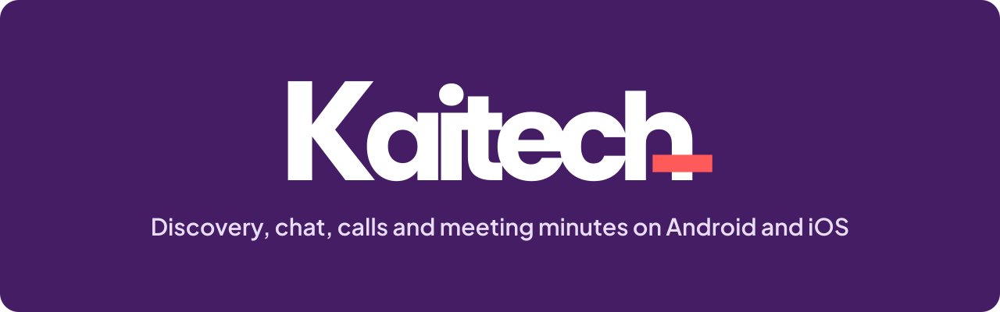

  

# Kaitech Mobile

The Kaitech app for Android and iOS. It brings the Kaitech Odoo workspace to phones and tablets: Discovery Programmes and the Coworker, chat, voice and video calls, and recorded meeting minutes, in English and Indonesian, on phones and tablets in portrait and landscape. The repo stores no server address, key, or token; release builds take the default server from repo variables at build time. The app signs in to the Kaitech server through the system browser, and another server can be chosen with "Use another server".

| Key fact | Value |
|---|---|
| Platforms | Android, iOS and iPadOS |
| Stack | React Native with Expo SDK 58 (development build, not Expo Go) |
| Node | 24 (`.nvmrc`) |
| Builds | GitHub Actions only, no EAS Build |
| App id | `io.kaitech.mobile` |

## Install

Download the latest build from [Releases](https://github.com/tickernelz/kaitech-mobile/releases/latest). These are test releases for the team, not store releases.

- Android: `kaitech-<build>-<sha>-arm64-v8a.apk`, see [Install the APK](docs/install-android.md).
- iOS: `kaitech-<build>-<sha>-unsigned.ipa`, re-signed with a personal Apple ID, see [Install the IPA](docs/install-ios.md).

What is proven and what is not yet verified: [Releases](docs/releases.md). What changed in each release: [Changelog](docs/changelog.md).

## Documentation

Everything else lives in [docs/](docs/README.md): development setup, sign-in, CI, E2E, calls, and the architecture of each feature.

## License

MIT, see [LICENSE](LICENSE).
